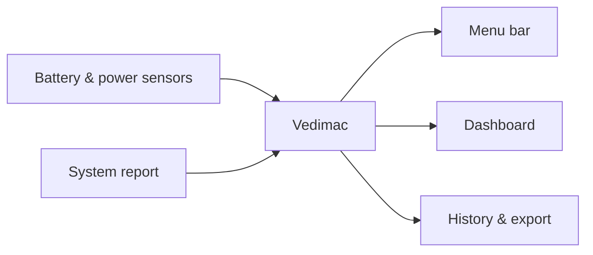
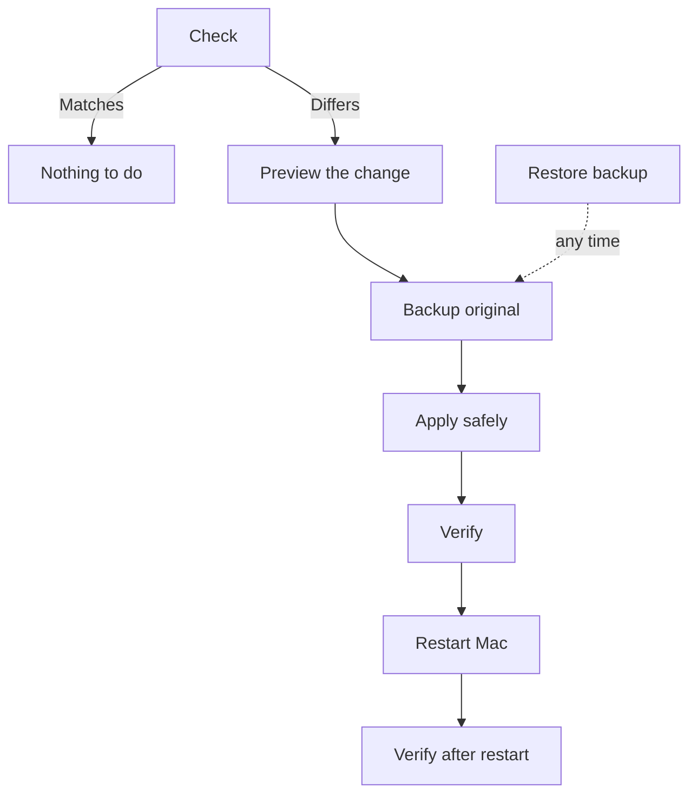

# Vedimac

**See what your MacBook's battery is really doing, and calibrate it safely.**

Vedimac is a small menu-bar app for Apple silicon MacBooks. It shows the battery and power numbers macOS keeps to itself, and it includes a safe, reversible way to try the battery-gauging calibration workaround.

> **Status:** early release (v1.0.3). The core logic passes 182 automated checks.
>
> ## ⚠️ Experimental, read before you use it
>
> - This is an **experimental** project. It is not an official Apple tool and Apple does not support it.
> - The calibration feature edits a macOS system file that controls how the battery is measured. **Its effects are not limited to the numbers Vedimac shows.** Changes can affect charge reporting and other battery behavior, and we cannot predict every outcome on every Mac.
> - Use it at your own risk. Keep a backup, read [Safety](#-safety), and skip calibration if you are not comfortable reverting a system change.
> - The dashboard, history and export features only read data. They do not change your Mac's settings.

---

## Contents

- [What you get](#-what-you-get)
- [Install](#-install)
- [How to use it](#-how-to-use-it)
- [Calibration (the advanced part)](#-calibration-the-advanced-part)
- [Update](#-update)
- [Uninstall](#-uninstall)
- [Safety](#-safety)
- [Where your data lives](#-where-your-data-lives)
- [For developers](#-for-developers)
- [License](#-license)

---

## ✨ What you get

| | Feature | What it shows |
|---|---|---|
| 🔋 | **Battery health** | Condition, maximum capacity, cycle count, design vs current capacity |
| ⚡ | **Power flow** | Adapter in, Mac in use, battery charging or discharging |
| 📈 | **History** | Charge, power and temperature over time, with a chart |
| 🧭 | **Calibration** | Checks and applies the gauging workaround, with backup and restore |
| 📤 | **Export** | CSV history, events and a diagnostic report, with privacy redaction |
| 🚫 | **No network** | Nothing leaves your Mac |



---

## 📦 Install

### You need

- A MacBook with Apple silicon (M1 or newer)
- macOS 14 (Sonoma) or newer
- Xcode Command Line Tools (run `xcode-select --install` once)

### Build it (the current way)

```bash
git clone https://github.com/Mokeshmiri/Vedimac.git
cd Vedimac
Scripts/build-app.sh
open dist/Vedimac.app
```

Drag **Vedimac.app** to **Applications** to keep it. A battery icon appears in the menu bar.

> 🔐 The app is not signed by Apple's developer program yet, so macOS may ask you to confirm it the first time. Open **System Settings → Privacy & Security** and click **Open Anyway**.

### Install with Homebrew

Coming soon. See the Homebrew section in the project notes.

---

## 🖱️ How to use it

1. **Click the battery icon** in the menu bar for a quick view.
2. Choose **Open Dashboard** for the full view:
   - **Overview:** charge, power flow and adapter details
   - **Health:** condition, capacity and cycles
   - **Calibration:** the workaround status and backups
   - **History:** charts over time
3. Use **Export** to save a CSV or diagnostic report. Turn on **Redact** first if you'll share it.

Vedimac records history about once a minute while it's running. Turn on **Open at login** so it keeps recording after restarts.

---

## 🧪 Calibration (the advanced part)

macOS sometimes shows a battery charge limit or a gauge that's out of step with the real battery. The calibration feature checks a battery-gauging setting and can update it, but **only with your permission**.



**Steps:**

1. Open **Calibration** and press **Check**. Nothing is changed.
2. Read the preview. It lists exactly which keys would change.
3. Press **Apply**. Vedimac asks for your administrator password.
4. Save your work and **restart** your Mac.
5. Open Vedimac and press **Verify after restart**.

**To undo it:** press **Restore** and pick a backup. Vedimac checks the backup before restoring it.

---

## 🔄 Update

With the build method, update by pulling the latest code and building again:

```bash
cd Vedimac
git pull
Scripts/build-app.sh
```

Then replace the app in Applications.

---

## 🗑️ Uninstall

1. Quit Vedimac.
2. Delete **Vedimac.app** from Applications.
3. If you used calibration, open the app and **Restore** first. Otherwise the system change stays in place.
4. Optional: delete the data folders listed in [Where your data lives](#-where-your-data-lives).

---

## 🛡️ Safety

- Calibration edits a macOS system file, and Vedimac always backs it up before writing.
- Writes are checked, and any unexpected change stops the operation.
- Restore checks the backup before putting it back.
- Vedimac needs an administrator password only for calibration.
- Nothing is sent over the network.

> ⚠️ If you're not comfortable editing a system setting, don't use calibration. The dashboard and history work without it.

---

## 📁 Where your data lives

| What | Where |
|---|---|
| History, events, settings | `~/Library/Application Support/ChargeWatch/` |
| Calibration backups (admin only) | `/Library/Application Support/ChargeWatch/Backups/` |
| Backup list | `/Library/Application Support/ChargeWatch/manifest.json` |

The folder names still say **ChargeWatch** on purpose. Renaming them would hide your existing backups.

---

## 👩‍💻 For developers

```bash
swift run gaugecheck   # runs the 182 checks
Scripts/test.sh        # prints the version, then runs the checks
```

Layout:

```
Sources/
├── GaugeCore/     plist logic, backups, safe writes
├── gaugectl/      the only tool that runs as admin
├── ChargeWatch/   menu bar and dashboard (SwiftUI)
└── gaugecheck/    checks (no XCTest needed)
```

---

## 📄 License

MIT. See [LICENSE](LICENSE).
